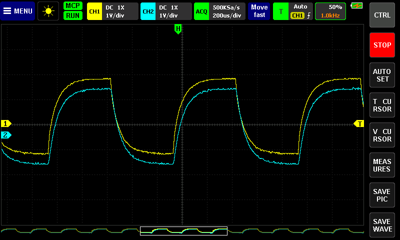
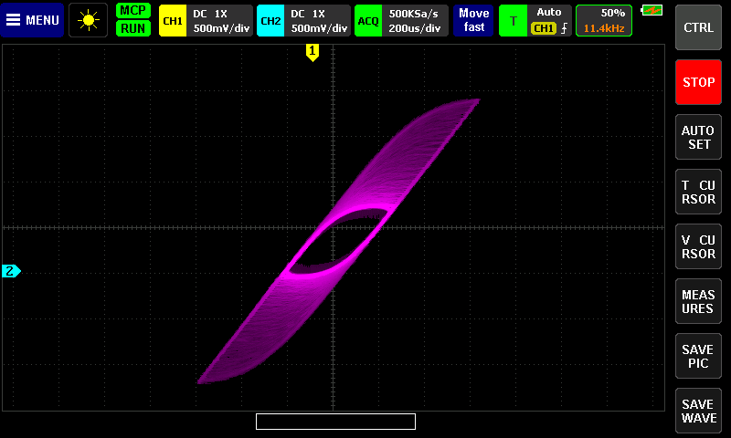

# fnirsi-1013d-mcp

[](https://github.com/mikljohansson/fnirsi-1013d-mcp/actions/workflows/ci.yml)
[](https://github.com/mikljohansson/fnirsi-1013d-mcp/releases)
[](LICENSE)

Open firmware for the FNIRSI 1013D tablet oscilloscope that boots from a micro SD card and gets far more out of the
hardware than the stock firmware does. It also lets an AI coding agent use the scope over USB, with you at the touch
screen the whole time.

## What you get that the stock scope cannot do

- **16,384 samples per channel instead of 3,000**, with a trigger you can place anywhere in the record.
- **Clean traces at every time base.** The FPGA filters the signal before it decimates, where the stock and Atlan
  firmware skip samples and alias.
- **A spectrum analyser** on the scope, with waterfall and density views.
- **A frequency-response mode** that measures a filter or tank with nothing but the scope and its calibration post.
- **A calibration wizard** that measures each ADC core of each channel.
- **Digital phosphor view**, also in X-Y.
- **External trigger** on the calibration post.
- **A diagnostics screen**: identity, FPGA features, calibration state, USB link, battery, an event log, a report
  saved to the card.
- **Your AI coding agent can drive the scope over USB** (Claude Code, Codex, any MCP client) while you keep using the
  touch screen: no remote lock-out, the screen follows the agent and the agent sees your changes.
- **Everything is reversible.** The stock firmware stays in the scope's flash. Pull the card and it is stock again.

| | |
|---|---|
|  |  |
| Scope view, two channels, an AI agent connected (the MCP chip) | Spectrum analyser, waterfall view |
|  |  |
| Frequency response of an RC ladder, measured by the scope alone | Digital phosphor view in X-Y |

## What you need

- An FNIRSI 1013D with the **Anlogic AL3A10** FPGA: an unmarked 144-pin chip next to a small Winbond 25Q80 flash
  with an unpopulated 2x3 header. [`docs/hardware-prep.md`](docs/hardware-prep.md) helps you identify your board.
- A spare micro SD card and a PC. Writing the card is tested on Linux and on WSL; the Windows path is untested.
- Only for the optional FPGA bitstream (the FPGA's configuration file, which adds the deep memory, the filters, the
  generator and the external trigger): a 3.3 V SPI programmer and a soldering iron for the six header pins.
- Everything was verified on one unit. The EF2L45 and Altera EP4CE6 variants are inherited from Atlan4's firmware
  and untested here; the bitstreams are for the AL3A10 only.

## Install

1. **Point your AI agent** (Claude Code, Codex, any MCP client) at a clone of this repository and ask it to guide
   you through hacking your scope. It will read [`docs/guide/agent-runbook.md`](docs/guide/agent-runbook.md) and
   walk you through the backups, the card and the bitstream.

Or by hand (every command and its expected result: [`docs/guide/install.md`](docs/guide/install.md)):

1. **Back up** the SD card you will use and, if you will flash a bitstream, the FPGA flash
   ([`docs/hardware-prep.md`](docs/hardware-prep.md), section 3).
2. **Download** `fnirsi_1013d-fw-X.Y.Z.bin`, `fnirsi_1013d-sdtools-X.Y.Z.zip` and `SHA256SUMS` from the
   [releases page](https://github.com/mikljohansson/fnirsi-1013d-mcp/releases) and check them:

   ```
   sha256sum -c SHA256SUMS --ignore-missing
   ```

3. **Prepare the card** with one FAT32 partition that starts at 8 MiB (sector 16384) or later, then build the SD
   parts from the tools zip. This downloads Atlan4's bootloader and updater from his repository and checks their
   hashes:

   ```
   python3 make_release_sd_package.py build --scope fnirsi_1013d-fw-X.Y.Z.bin --scope-sha256 <hash from SHA256SUMS> --parts parts
   ```

4. **Write the parts** to the card (Linux, or WSL with the card reader attached):

   ```
   python3 make_sd_image.py write --device /dev/sdX --bootloader parts/bootloader.bin --updater parts/updater.bin --scope parts/scope.bin --boot-mode 4
   ```

5. **Optional, the bitstream**: flash 0x153B with your SPI programmer as
   [`fpga/al3/dist/BITSTREAMS.md`](fpga/al3/dist/BITSTREAMS.md) describes. Then boot, and run the calibration
   wizard when the first-run screen asks ([`docs/guide/first-run.md`](docs/guide/first-run.md)).

## Risks and the way back

- **Back up first**, and keep the backups: the SD card, and the FPGA flash twice (the two reads must match).
- **Never `dd` the whole SD package** to the card. That wipes the calibration, settings and boot-mode sectors. The
  card tool writes only the parts you give it.
- **The boot menu** at power-on offers the open firmware, the stock firmware and FEL (the chip's USB recovery mode,
  through which a PC can load firmware into RAM). Remove the card and the stock firmware runs.
- **FPGA rollback**: write your backup of the FPGA flash back with the same programmer. Do this before you go back to
  the stock firmware for good: the stock firmware does not run on a custom bitstream.
- **Use at your own risk.** A wrong programmer pin or 5 V logic can damage the board, and a failed write can leave
  the scope unbootable until you restore a backup.

## Let your AI agent use the scope

```
uv tool install <URL of the release's fnirsi1013d-X.Y.Z-py3-none-any.whl>   # or pipx install / pip install
fnirsi1013d-mcp --list-tools
claude mcp add --scope user fnirsi1013d -- fnirsi1013d-mcp --port auto
```

Then ask, for example: "average 32 captures at 1 MS/s and fit the decay after the trigger". Codex setup, the
simulator for trying it without a scope, and what an agent should know before it measures:
[`docs/agent-setup.md`](docs/agent-setup.md).

## Documentation

Site: <https://mikljohansson.github.io/fnirsi-1013d-mcp/>

| Shelf | Start here |
|---|---|
| User guide: install, first run, calibration, every screen, the generator | [`docs/guide/install.md`](docs/guide/install.md) |
| Agent guide: setup, the MCP tools and their safety tiers, the measurement guide | [`docs/agent-setup.md`](docs/agent-setup.md) |
| Engineering: building, the protocol, the articles on the hard parts, the bench log | [`docs/development.md`](docs/development.md) |

## Contributing and reports from other units

Issues and pull requests are welcome, from people and from agents. The most useful contribution is a report from
another unit: the FPGA variant and the bitstream version shown in Diagnostics, the firmware version, what you did,
what you saw, and whether the calibration wizard passes. How to build and test: [`docs/development.md`](docs/development.md).

## Credits

- [pecostm32](https://github.com/pecostm32): the reverse engineering (schematics, FPGA bus traces, emulator) and the
  original open firmware.
- [Atlan4](https://github.com/Atlan4/Fnirsi1013D): years of firmware development, calibration, the custom FPGA
  bitstreams for all three variants, the bootloader and updater.
- [Donwulff](https://github.com/Donwulff/FNIRSI_1014D_Firmware): audited fixes, a test harness and the headless
  Anlogic TD flow.
- The EEVblog "FNIRSI-1013D 100MHz tablet oscilloscope" thread community.
- Research, firmware, MCP server and bench work were done by Claude through Claude Code agents, coordinated by
  [@mikljohansson](https://github.com/mikljohansson), who owns the scope, the soldering iron and the decisions.

## Licence

GPL-3.0, inherited from the pecostm32 and Atlan4 code this derives from. See [`LICENSE`](LICENSE).
