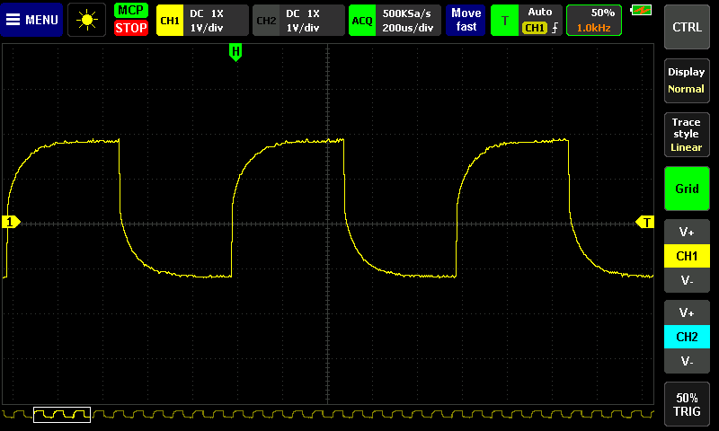
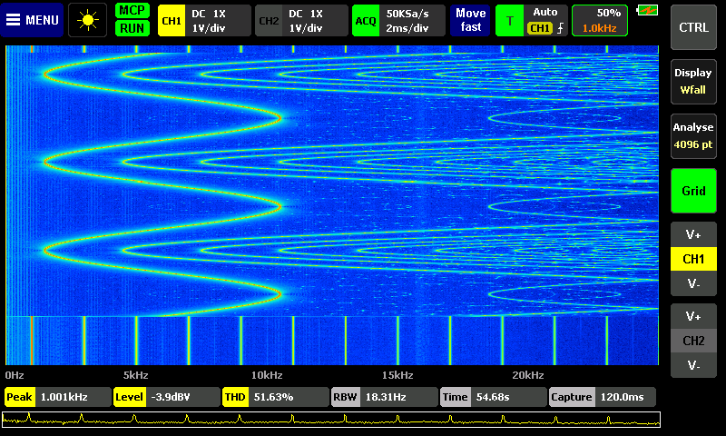
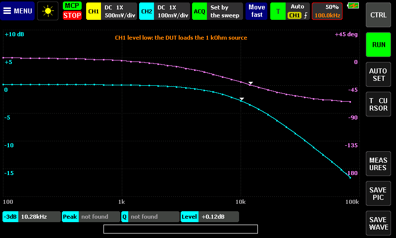
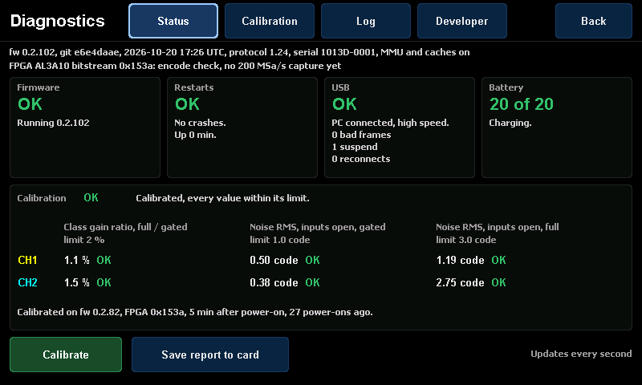
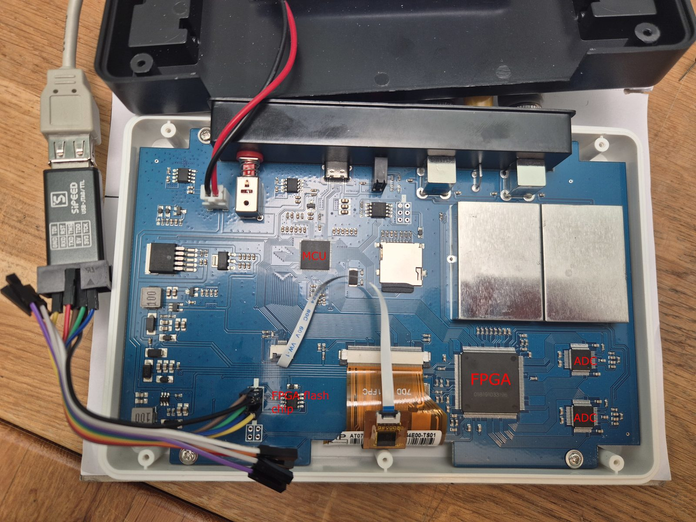
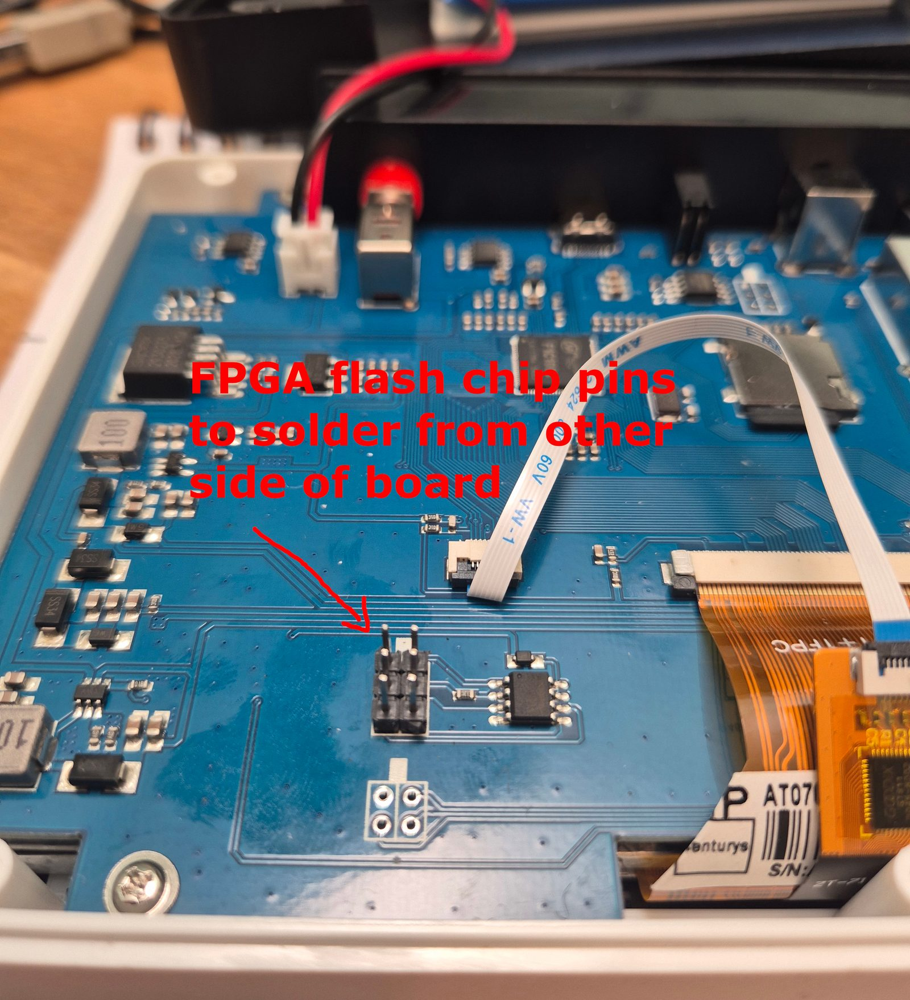

# fnirsi-1013d-mcp

[](https://github.com/mikljohansson/fnirsi-1013d-mcp/actions/workflows/ci.yml)
[](https://github.com/mikljohansson/fnirsi-1013d-mcp/releases)
[](LICENSE)

Open firmware for the FNIRSI 1013D tablet oscilloscope that boots from a micro SD card and gets far more out of the
hardware than the stock firmware does. It also lets an AI coding agent use the scope through an MCP connection over
USB, with you at the touch screen the whole time.

Most of it was written by AI agents coordinated by the maintainer, and everything was verified on the maintainer's
single unit. Opening the case may void your warranty.

## What it costs

A spare micro SD card, a 2x3 header soldered to the board, a 3.3 V SPI programmer such as an FT2232 or FT232H board,
and an evening. The stock firmware stays in the scope's own flash, and the boot menu at power-on offers it beside the
open firmware (and FEL, the chip's USB recovery mode). Going back to stock needs your backup of the FPGA flash written
back first, so keep that backup.

## What you get
**On the scope**
- **Scope view**: six hardware ranges plus software zoom; **16,384 samples per capture and channel instead of
  3,000**, with the trigger placed anywhere in the capture by dragging; trigger Auto, Normal or Single on
  a rising or falling edge of CH1, CH2 or an external signal on the calibration post; sample rate, time
  per division and memory depth; roll mode; twelve measurements per channel as cards; time and voltage cursors;
  digital phosphor with persistence and a heat palette; X-Y; an overview bar under every plot that previews the whole
  capture, spectrum or sweep, with a window you drag.
- **Averaging of successive captures** (ACQ > Average): the FPGA sums them at the fast rates, the MCU for filtered and
  slow captures.
- **Clean traces at every sweep speed**: Acquisition > Filter picks boxcar, CIC2 or CIC3, with or without
  the compensation FIR, and the FPGA filters the 200 MS/s stream before it slows it down, where the stock and Atlan
  firmware skip samples and show ghost signals that are not there.
- **Spectrum analyser**: FFT of 1024 to 4096 points, Hann, flat-top or rectangular window, averaging and max hold,
  waterfall and density views, THD, tap to zoom, drag to pan, AUTO SET.
- **Frequency response analyser, a Bode plot**: magnitude and phase against frequency of a filter, divider
  or tank with the scope alone. The calibration post (the square-wave output hook on the side of the scope) drives
  it, CH1 and CH2 read its input and output; AUTO SET finds the span, cards give the corner frequency, peak and Q,
  the table saves as CSV.
- **Generator**: a square wave on the calibration post, frequency and duty of your choice.
- **The ADCs are calibrated core by core, and the firmware checks every fast capture.** Each channel is two
  interleaved ADC cores; the wizard measures a zero and a gain per core and clock class, a tracker follows the
  full-rate drift in the background, the wizard also trains when the FPGA captures each core's data, the FPGA
  self-checks every 200 MS/s capture, and a garbled one is taken again.
- A first-run screen, **Diagnostics** (status tiles, a calibration page, an event log, a report saved to the card),
  viewers for saved pictures and waveforms, Settings, USB drive mode.

**From your AI agent over USB** (30 tools in the default profile; raw FPGA access is off unless you enable it; no
remote lock-out: you and the agent change the same live settings, and the screen follows)
- **Read**: identity, capabilities, status, settings, calibration and voltage scaling, event log, the scope's own
  spectrum, card info, health, a screenshot; a report with a plot and an HTML page of any result.
- **Set**: channel range, coupling, probe factor and offset; sample rate; decimation filter; trigger
  source, edge, level in volts, mode, position before the trigger, capture length and auto time-out.
- **Capture**: one capture, or a time window of it, with the raw ADC codes per core; the trace on the screen;
  arm, wait, force and stop; averaged captures aligned on an edge, or summed in the FPGA; a burst of
  triggers captured back to back (built and simulator-tested, not yet benched); capture and FFT; a
  pulse-induction decay fit; measurements; calibrate volts against a known DC voltage.
- **Drive**, each with a confirmation token: the generator, a loopback self-test, a Bode sweep. Every
  hardware-changing call goes to an audit log.

**Host tools** in the same package: **firmware updates from your PC over USB**, no card swapping
(`fnirsi1013d-flash` reboots the scope into FEL, loads a new image into RAM and can write it to the card after a
backup); `fnirsi1013d-bode` (a sweep to CSV, JSON and NPZ); `fnirsi1013d-sd` (card sectors over USB);
`fnirsi1013d-bench`, `fnirsi1013d-soak`; `fnirsi1013d-sim` (the simulator: every tool without a scope). Two Claude
Code skills: `fnirsi-scope` (how to measure) and `fnirsi-install` (the install runbook).

| | |
|---|---|
|  |  |
| A 16,384-sample capture with the trigger near the start | Spectrum analyser, waterfall view |
|  |  |
| Frequency response of an RC ladder, measured by the scope alone | Diagnostics, all checks OK |

## What's next

Ideas, not promises ([`docs/plans/roadmap.md`](docs/plans/roadmap.md), sections 6 and 8): more trigger types (pulse
width, Nth edge, runt, window, timeout) behind a Type row in the trigger menu; peak-detect acquisition; a streaming
data logger (continuous filtered samples at up to about 1 MS/s into the 32 MB RAM and on to the host); a pulse pattern
generator with a trigger output; a hardware frequency and period counter feeding the measurement cards; deeper plain
memory (about 24,576 samples per channel from the spare block RAM); a DVM readout, serial decode, mask testing and
CSV export; and testers with EF2L45 and EP4CE6 units.

## What you need

- [ ] **An FNIRSI 1013D with the Anlogic AL3A10 FPGA.** There is no way to tell from outside: open the back and
  compare with the photo. The FPGA is the unmarked 144-pin chip; next to it sits a small 8-pin flash chip marked
  25Q80 with an empty 2x3 header. A chip marked EF2L45 or EP4CE6 is another variant, inherited from Atlan4's firmware
  and untested here ([`docs/hardware-prep.md`](docs/hardware-prep.md)).
  
- [ ] **A spare micro SD card** (up to 32 GB if you format it on Windows).
- [ ] **A PC.** Every command runs in a WSL Ubuntu terminal or on Linux; a card reader is attached to WSL with
  `usbipd` ([`docs/guide/install.md`](docs/guide/install.md)).
- [ ] **A 3.3 V SPI programmer** for the FPGA bitstream. The FT2232D route is the tested one. A plain CH341A
  can drive 5 V on the data lines and has killed a flash ([`docs/hardware-prep.md`](docs/hardware-prep.md),
  section 2.2). Six pins go on the header, soldered from the back:
  

## Install

**Let your AI agent guide you.** Install [Claude Code](https://claude.com/claude-code) or Codex, run
`git clone https://github.com/mikljohansson/fnirsi-1013d-mcp`, open a terminal in that folder, start the agent
(`claude` or `codex`) and type: *"Read docs/guide/agent-runbook.md and guide me through installing this firmware on
my FNIRSI 1013D."* The agent prepares each command and checks its output, you do the physical steps, and it stops
when any check fails. In Claude Code the `fnirsi-install` skill picks the runbook up by itself.

### By hand (a WSL or Linux shell; every command with its expected result: [`docs/guide/install.md`](docs/guide/install.md))

1. **Back up** the SD card you will use and the FPGA flash, twice ([`docs/guide/prepare.md`](docs/guide/prepare.md)).
2. **Flash the bitstream** (0x153B) with your SPI programmer as [`fpga/al3/dist/BITSTREAMS.md`](fpga/al3/dist/BITSTREAMS.md)
   describes. The FPGA comes before the card: with the stock bitstream, this firmware only shows a banner.
3. **Download** `fnirsi_1013d-fw-X.Y.Z.bin`, `fnirsi_1013d-sdtools-X.Y.Z.zip` and `SHA256SUMS` from the
   [releases page](https://github.com/mikljohansson/fnirsi-1013d-mcp/releases) and check them with
   `sha256sum -c SHA256SUMS --ignore-missing`.
4. **Prepare the card** with one FAT32 partition that starts at 8 MiB (sector 16384) or later: the `parted` and
   `diskpart` commands are in [`docs/guide/install.md`](docs/guide/install.md), "Prepare the card".
5. **Build the parts** from the tools zip. This downloads Atlan4's bootloader and updater from his repository and
   checks their hashes:

   ```
   python3 make_release_sd_package.py build --scope fnirsi_1013d-fw-X.Y.Z.bin --scope-sha256 <hash from SHA256SUMS> --parts parts
   ```

6. **Write the parts** to the card:

   ```
   python3 make_sd_image.py write --device /dev/sdX --bootloader parts/bootloader.bin --updater parts/updater.bin --scope parts/scope.bin --boot-mode 4
   ```

7. **Boot**, and run the calibration wizard when the first-run screen asks ([`docs/guide/first-run.md`](docs/guide/first-run.md)).

**Risks and the way back.** Back up first and keep the backups: the SD card, and the FPGA flash twice (the two reads
must match). The stock firmware does not run on a custom bitstream, so that FPGA backup is your way back to stock.
Never `dd` the whole SD package to the card: that wipes the calibration, settings and boot-mode sectors.
A wrong programmer pin or 5 V logic can damage the board, and a failed write can leave the scope unbootable until you
restore a backup. Use at your own risk.

## Let your AI agent use the scope

```
uv tool install <URL of the release's fnirsi1013d-X.Y.Z-py3-none-any.whl>   # or pipx install / pip install
fnirsi1013d-mcp --list-tools
claude mcp add --scope user fnirsi1013d -- fnirsi1013d-mcp --port auto
```

Then ask, for example: "measure the ripple on my power supply and tell me its frequency", or "average 32 captures at
1 MS/s and fit the decay after the trigger". Codex, the simulator for trying it without a scope, and what an agent
should know before it measures: [`docs/agent-setup.md`](docs/agent-setup.md).

## Documentation

| Shelf (all on the [documentation site](https://mikljohansson.github.io/fnirsi-1013d-mcp/)) | Start here |
|---|---|
| User guide: install, first run, calibration, every screen, the generator | [`docs/guide/install.md`](docs/guide/install.md) |
| Agent guide: setup, the MCP tools and their safety tiers, the measurement guide | [`docs/agent-setup.md`](docs/agent-setup.md) |
| Engineering: building, the protocol, articles on how each feature was built, what was measured on the unit | [`docs/development.md`](docs/development.md) |

## Contributing and reports from other units

Issues and pull requests are welcome, from people and from agents ([`docs/development.md`](docs/development.md) says
how to build and test). The most useful contribution is a report from another unit: the FPGA variant and bitstream
version shown in Diagnostics, the firmware version, what you did and saw, and whether the calibration wizard passes.

## Credits

Built on the work of [pecostm32](https://github.com/pecostm32) (the reverse engineering: schematics, FPGA bus traces,
emulator, and the original open firmware), [Atlan4](https://github.com/Atlan4/Fnirsi1013D) (years of firmware
development, calibration, the custom FPGA bitstreams for all three variants, the bootloader and updater),
[Donwulff](https://github.com/Donwulff/FNIRSI_1014D_Firmware) (audited fixes, a test harness and the headless Anlogic
TD flow) and the EEVblog "FNIRSI-1013D 100MHz tablet oscilloscope" thread community. Research, firmware, MCP server
and bench work were done by Claude through Claude Code agents, coordinated by
[@mikljohansson](https://github.com/mikljohansson), who owns the scope, the soldering iron and the decisions.

## Licence

GPL-3.0, inherited from the pecostm32 and Atlan4 code this derives from. See [`LICENSE`](LICENSE).
