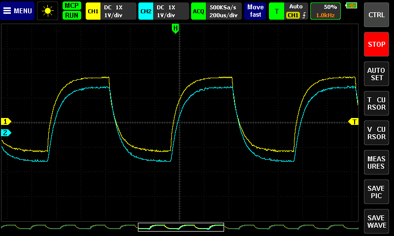
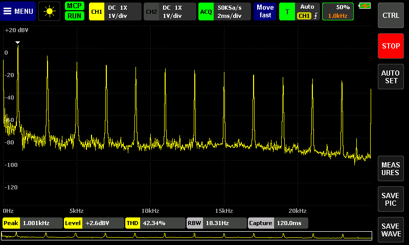
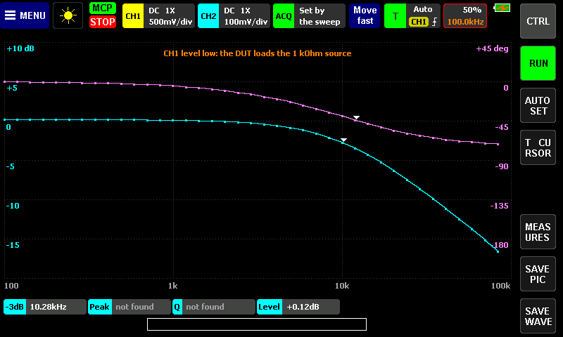
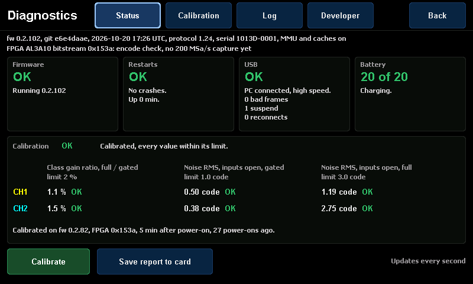
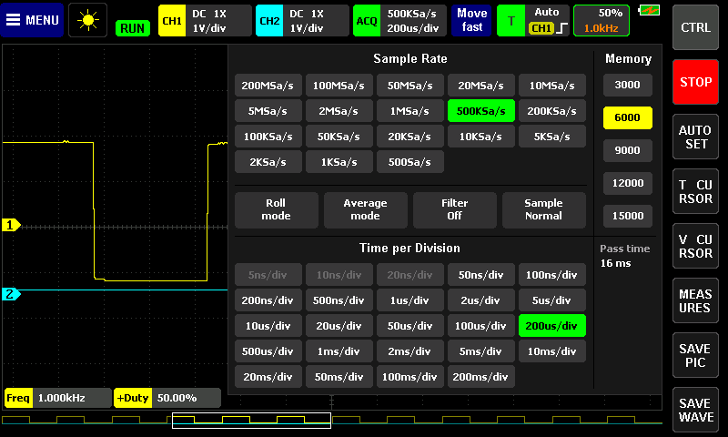
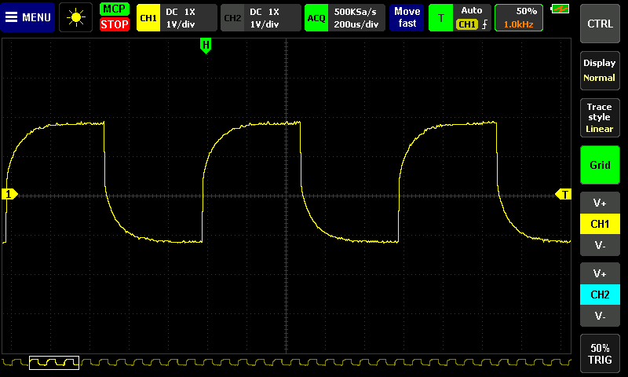

First public release of the open firmware, FPGA bitstreams and MCP server for the FNIRSI 1013D tablet oscilloscope
(Anlogic AL3A10 variant). The firmware runs from the SD card and leaves the stock firmware in the MCU flash untouched;
a USB protocol and a Python MCP server let an AI agent (Claude Code, Codex, any MCP client) configure the scope, capture
and analyse while you keep using the touch screen.

Documentation: <https://mikljohansson.github.io/fnirsi-1013d-mcp/> (install guide, the screens, the agent guide).

| | |
|---|---|
|  |  |
| Scope view, with a host connected (MCP chip) | Spectrum analyser |
|  |  |
| Frequency response on the scope | Diagnostics, Status page |
|  |  |
| ACQ menu: Filter Off / Hi-Res / Anti-alias, Sample Normal / Peak | 16,382 samples per channel |

### Highlights

- **Frequency response on the scope**: the calibration post drives a passive filter or tank, CH1 and CH2 read its
  input and output, and the screen plots magnitude and phase with markers, cursors and cards (-3 dB, peak, Q, level,
  phase crossings). AUTO SET finds the span and stops; RUN repeats sweeps for live tuning and reuses the ranges of the
  previous sweep, so the relays stay quiet on an unchanged circuit; SAVE WAVE writes the table as CSV. Points the
  scope cannot measure are drawn grey, with a note that says what to change.
- **Calibration wizard with capture-stage training.** Each channel is two interleaved ADC cores. The wizard measures
  zero and gain per core and per clock class, and it first trains the stage at which the FPGA captures each core's
  data, over a band of codes around mid-scale. After every 200 MSa/s capture a self-check counts outlier samples;
  Diagnostics asks for a new calibration when a core is flagged repeatedly. A background tracker follows the
  full-rate drift, and a first-run screen leads an uncalibrated unit to the wizard.
- **Trigger types, peak detect and a hardware counter.** Pulse width (shorter or longer than a time), Nth edge after an
  idle time, and timeout triggers on CH1, CH2 or EXT, with a trigger hold-off (the trigger menu's Type row). Peak
  detect keeps the minimum and maximum of every sample window, so a 1 us spike shows at a slow time base (the ACQ
  menu's Sample row). A reciprocal frequency counter in the FPGA feeds the Freq, Period, Width and Duty cards with its
  level and hysteresis following the signal.
- **Streaming logger and roll mode.** Log one or both channels to the PC continuously, for a duration or until stopped: 500 kS/s
  8-bit on one channel, 250 kS/s 16-bit on one or 8-bit on two, 125 kS/s 16-bit on two; a lost stretch is marked,
  never hidden. Roll mode (100 ms/div and slower) draws real samples of both channels from the same stream.
- **Square-wave generator** on the calibration pin: every edge within 5 ns of ideal, the mean frequency exact, and a
  frequency or duty change takes effect without a glitch. The Frequency response and the host's chirps use it.
- **MCP server and USB protocol.** Binary, CRC-checked protocol over USB CDC, no driver on Windows or Linux. 41 MCP
  tools with safety tiers: 39 are available by default, raw FPGA access and the reboot into FEL only when enabled;
  anything that drives the calibration pin needs a confirmation. Besides capture, averaging, FFT, decay fits and
  Bode sweeps, the host decodes UART, SPI and I2C from a capture, runs mask tests, reads like a DVM and exports any
  result as CSV. An audit log of every hardware-changing call, a device
  simulator to try it without a scope, plots and HTML reports of saved results, and a Claude Code skill with the
  measurement rules (`.claude/skills/fnirsi-scope`). The server frees the serial port after 30 s without a tool call.
- **Documentation site** at <https://mikljohansson.github.io/fnirsi-1013d-mcp/>: install, first run, calibration, each
  screen with a screenshot from the unit, the generator, the agent setup and measurement guide, and the bench log.
- **Shared control.** No remote lock-out: you and the agent change the same live settings, and a chip in the top bar
  shows that a host is connected. A host command closes an open menu instead of waiting for it.
- **Spectrum analyser on the scope**: FFT up to 4096 points, Hann / flat-top / rectangular windows, averaging and max
  hold, waterfall and density views, tap to zoom, drag to pan, Auto; the span sets the sample rate.
- **FPGA decimation filters**: boxcar, CIC2 and CIC3, plus a compensation FIR, so slow time bases no longer alias by
  skipping samples. Captures then carry 16-bit samples. The ACQ menu's Filter offers Off, Hi-Res (boxcar) and
  Anti-alias (CIC3 + FIR); every combination stays available over MCP.
- **Diagnostics** (Menu > Diagnostics): firmware identity, FPGA bitstream and features, calibration state and
  provenance, USB link, restarts, battery, an event log, and a report saved to the card.
- **Digital phosphor view**, persistence 0.2 s / 1 s / 5 s / infinite, mono or heat palette, also in X-Y.
- **External trigger** on the calibration pin.
- **Segmented capture and hardware averaging** over MCP.
- **Bode plot from the host**: `scope_bode_sweep` and `fnirsi1013d-bode` sweep the generator and measure magnitude and
  phase with both channels.
- **Hands-free development loop**: `fnirsi1013d-flash` reboots the scope into FEL, loads a build into RAM and can
  persist it to the card after a backup. Images are reproducible: the same commit gives the same sha256 everywhere.

### FPGA bitstream

**This firmware runs with bitstream 0x153D only**, the one supported pair being firmware 0.3.0 with 0x153D. Any other
bitstream, older or newer, shows a banner that names the one needed. 0x153D carries the trigger types (pulse width,
Nth edge, timeout) with hold-off, peak detect, the hardware counter, the streaming logger with roll mode, and the
accurate fractional square-wave generator on the calibration pin (the DDS is gone and there is no pattern generator).

On the owner's unit (bench of 2026-10-22, firmware 0.2.105, which this release's firmware follows): the wizard trained
the capture stages with the inputs open; with a 1 kHz square through an RC network on CH2 and the filter off, no
sample was 4 or more codes off its neighbours at 2 MSa/s, and at 200 MSa/s 0.37 % of core B's samples and 3.32 % of
core A's were (see Known issues); on the calibration square the hardware counter read 999.996 Hz at 200 MSa/s and 1000.004 Hz with a filter at
500 kSa/s; a five-minute session of status polls, health reads and two-channel captures over USB had no errors. The
streaming logger delivered every word at its three rates (20 s at 500 kS/s 8-bit, 20 s at 250 kS/s 16-bit, 60 s of two
channels at 125 kS/s 16-bit), and roll mode scrolled a 1 Hz square, both measured on a pre-release build of 0x153D
with the same logger.
<!-- The 0x153D bench above is the gated build fd0be7a2 (docs/hardware-status.md 2026-10-22 17:01-19:52); the logger and
roll numbers are from the first, full-rate 0x153D build (08:47-09:02), whose logger logic fd0be7a2 keeps. The release
image itself is FEL-checked and persisted after the tag (release-checklist); re-check this paragraph then. -->

Its lineage: 0x153C brought the trigger types with hold-off, peak detect and the hardware counter, and dropped the
stock design's unused registers. 0x153B made a record that ends on the auto time-out the newest stretch of samples;
up to 0x153A such a record could be joined from two passes of the sample memory, with a jump in the trace (on the
owner's unit 0 of 100 untriggered captures were joined after the fix, and ten Frequency response sweeps of an RC
network, 100 Hz to 1 MHz, needed no retakes). 0x153A captures the ADC data at a selectable stage per core, which ends
the garbled cores near mid-scale that 0x1537 to 0x1539 showed, and adds the capture self-check (it flagged 0 of 18,865
captures on the owner's unit). The earlier versions brought the external trigger on the calibration pin, the
decimation filters and the compensation FIR, segmented capture and hardware averaging, and the 32-bit DDS generator
that the square generator replaced.

The release also attaches 0x1533 to 0x1536 and 0x153A to 0x153C for the record; this firmware does not run with them. 0x1537 to
0x1539 are withdrawn and not attached. `BITSTREAMS.md` lists every version with its hashes, the programmer wiring and
the rollback. Calibrate again after flashing: the calibration and the trained capture stages are stored per ADC core
and per bitstream.

### Install

The full guide with every command is at <https://mikljohansson.github.io/fnirsi-1013d-mcp/guide/install/>.

1. Back up the SD card and the FPGA's config flash, twice (`docs/guide/prepare.md`, or
   <https://mikljohansson.github.io/fnirsi-1013d-mcp/guide/prepare/>).
2. Download the assets below and check them: `sha256sum -c SHA256SUMS --ignore-missing`.
3. Flash bitstream 0x153D (`fnirsi_1013d-fpga-al3-0x153d-flash1m.bin`) with a 3.3 V SPI programmer, as `BITSTREAMS.md`
   (attached) describes. The bitstream is required: the FPGA comes before the card, because with any other bitstream
   this firmware only shows a banner.
4. Build the SD parts on your machine; this downloads Atlan4's bootloader v0.8 and updater from his repository and
   checks their hashes: `python3 make_release_sd_package.py build --scope fnirsi_1013d-fw-0.3.0.bin --scope-sha256
   <hash from SHA256SUMS> --parts parts` (from the `sdtools` zip).
5. Prepare a spare micro SD card: an MBR with one FAT32 partition that starts at **8 MiB (sector 16384)** or later.
   The firmware sits in the raw sectors before the partition, and the image is about 0.8 MB, so it ends near sector
   2260, past the 1 MiB or 4 MiB start most cards come with. Recreate the partition (the install guide, "Prepare the
   card"; this erases the card's files). Then write only those parts:
   `python3 make_sd_image.py write --device /dev/sdX --bootloader parts/bootloader.bin --updater parts/updater.bin
   --scope parts/scope.bin --boot-mode 4`. The tool refuses a card whose partition starts too low and names the start
   it needs; it never changes the partition table. Do not `dd` the whole package: that wipes calibration, settings and
   the boot-mode sector.
6. Boot, and run the calibration wizard when the first-run screen asks (inputs open and USB unplugged for the zero
   level, then each probe at x1 on the calibration post).
7. MCP: `uv tool install <URL of the attached .whl>`, then
   `claude mcp add --scope user fnirsi1013d -- fnirsi1013d-mcp --port auto`. Without a scope:
   `fnirsi1013d-mcp --sim`.

### Before you flash anything

- **Verified on one unit, the AL3A10 variant.** The EF2L45 and EP4CE6 code paths are inherited from Atlan4 and untested
  here; the bitstreams are for the AL3A10 only.
- **The FPGA needs an SPI programmer** on the 2x3 config-flash header (pins to solder, pinout to check by continuity).
  The scope cannot write its FPGA flash itself. Back up the flash twice and compare before writing.
- **The stock firmware stays.** Remove the card, or pick FNIRSI in the boot menu, and the stock firmware runs. With a
  custom bitstream, restore the stock bitstream first.
- Real limits are unchanged: 200 MS/s per channel, 8 bit, about 30 MHz bandwidth, no DAC (the generator is a
  logic-level square wave on the calibration pin).
- Use at your own risk; keep your backups.
- Tested on: one unit, the owner's FNIRSI 1013D with the Anlogic AL3A10 FPGA (JTAG IDCODE 0x18006C31), bootloader
  v0.8, bitstream 0x153D (0x153A to 0x153C before it), development firmware up to 0.2.105. 0.2.101, 0.2.102 and
  0.2.105 were written to the card with `fnirsi1013d-flash --persist` and booted from it. The PC side ran on Windows 11
  (the MCP server on
  the scope's COM port, WSL Ubuntu for FEL loading and the card tools); the host tests also run on Linux and Windows in
  CI. The bench log is `docs/hardware-status.md`.

### Known issues

- **One unit.** Everything was benched on a single AL3A10 unit. The gains measured on one range are applied to all six
  ranges (not yet checked range by range).
- **Not benched on the unit**: the external trigger from an outside source (it was tested only in a loopback through
  the scope's own generator; an outside source must be 3.3 V logic referenced to the USB ground); segmented capture's
  timestamps and hardware averaging against host averaging (segmented records were checked only for being contiguous).
- **Frequency response, relays.** On a span that needs several CH2 ranges, every RUN sweep switches CH2's range where
  the response crosses a range boundary (twice per sweep on an RC low-pass from 100 Hz to 1 MHz). AUTO SET chooses
  CH2 range Constant, which switches nothing, only when the response inside its span stays within 20 dB. You can set
  Constant by hand in CTRL > Sweep; points that fall too low for the range are then drawn grey.
- **Frequency response, grey points without a note.** With CH2 range Auto, points that are too small on a range
  coarser than 100 mV/div are grey but get no note of their own; the note that names the frequency and the remedy
  appears only for the finest range.
- **Frequency response, probe.** Above about 2 MHz an x1 probe on the calibration post rolls off, and the sweep says
  "CH1 level low above 2 MHz: the x1 probe rolls off".
- **Frequency response, limits.** CH2 is always DC coupled, there is no impedance mode, and the post can drive only
  passive or buffered circuits. A very sharp resonance can make AUTO SET say "peak not confirmed: sweep by hand".
- **The firmware runs only with bitstream 0x153D**; other bitstreams show a banner.
- **CH2 core A at 200 MSa/s.** On the owner's unit, with the filter off at 200 MSa/s, 3.32 % of CH2 core A's samples
  (every other sample of CH2) read 4 or more codes high, almost all of them where the signal sits just below ADC code 96
  (12 % of the samples in codes 88 to 95, at most 0.3 % in any other band); core B read 0.37 %. The previous bitstream
  0x153C read about 1 % on core A in a similar run, and both read 0 % at 2 MSa/s. The owner accepted 0x153D with this;
  a later bitstream may tune the capture timing further. On a trace it shows as small spikes at one level; other units
  may differ, since the capture stages are trained per unit.
- **Hardware counter with the filter off.** Below 200 MSa/s with Filter Off the ADCs run at the divided rate, so the
  counter does not count there: the Freq, Period, Width and Duty cards show the record's own measurement instead, and
  `scope_counter` says the result is gated. With Hi-Res or Anti-alias, with Peak, or at 200 MSa/s the cards use the
  counter.
- **USB after a long idle.** An early firmware lost its USB device after a long idle with the port closed; the recovery
  added since passed three 30-minute idles, but the two-hour check has not been completed. If the scope's port is gone
  after hours of idle, unplug and replug the cable.
- **Diagnostics, Restarts tile.** The crash count also counts deliberate restarts (a firmware load over FEL, an
  update) that followed a crash in the same chain, and a deliberate restart after a crash overwrites the stored crash
  record, so that crash then reads OK.
- **Phosphor view** draws about 30 records per second, so a rare event needs time to show. **Waterfall and Density**
  show one channel at a time.
- **Spectrum averaging** averages the dB levels: on noise it reads about 2.5 dB low. Use the MCP tools for calibrated
  noise power.
- **Anti-alias filter** (CIC3 with the compensation FIR): a square wave's edges overshoot by up to about 7 %, varying
  with where the edge falls on the sample grid. The Scope's default filter is Hi-Res (no FIR) for that reason.
- **ACQ Average** averages as many records as fit a 40 ms budget per screen update (2 to 64): at slow sample rates
  (10 kSa/s and below) the screen shows single records.
- **Touch**: while a finger rests on the screen without moving, the screen does not update.
- **Card tools on Windows**: `make_sd_image.py` accepts `\\.\PhysicalDriveN`, but that path is untested. Use Linux or
  WSL.

### Credits

pecostm32 (reverse engineering and the original open firmware), Atlan4 (years of firmware development, the custom FPGA
bitstreams, the bootloader and updater), Donwulff (audited fixes and the headless Anlogic TD flow), and the EEVblog
FNIRSI 1013D thread. Research, firmware, MCP server and bench work were done by Claude (Fable 5.1, via Claude Code
agents) coordinated by and with the owner, who owns the scope, the soldering iron and the decisions. The developer
history of every build up to this release is in `CHANGELOG.md`.
