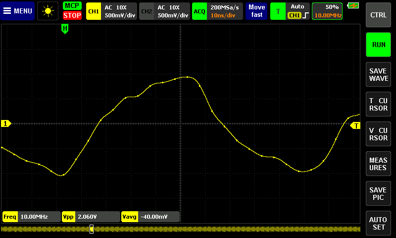
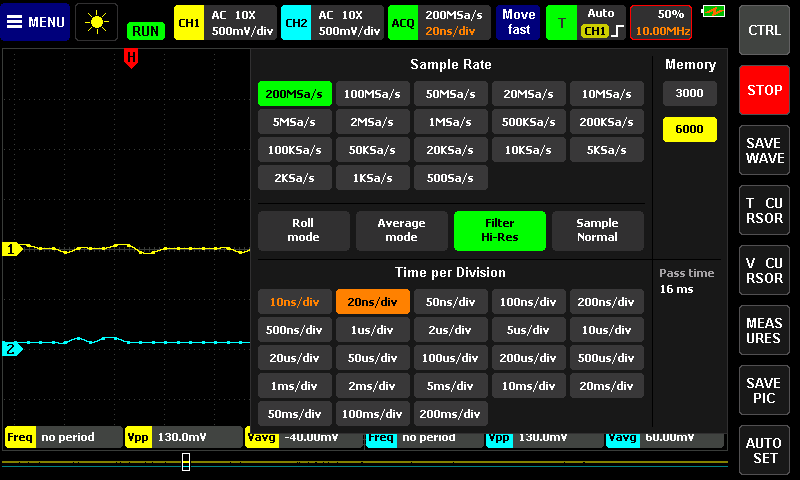

A feature release of the open firmware and MCP server for the FNIRSI 1013D (Anlogic AL3A10 variant): the scope gets
its two fastest time bases back, 20 and 10 ns/div, drawn the way bench scopes draw them. It needs the same FPGA
bitstream as 0.3.0 to 0.3.5, **0x153F**, so you only update the firmware on the card. Your calibration stays valid.

Documentation: <https://mikljohansson.github.io/fnirsi-1013d-mcp/> (install guide, the screens, the agent guide). The
0.3.0 notes describe everything this firmware does: <https://github.com/mikljohansson/fnirsi-1013d-mcp/releases/tag/v0.3.0>.

| | |
|---|---|
|  |  |
| 10 MHz at 10 ns/div: the curve is computed, the dots are the samples | The ACQ menu: the interpolated time bases are orange |

### What changed

- **20 ns/div and 10 ns/div.** The scope samples at 200 MSa/s, so a division of these holds only four or two
  samples, and until now the firmware refused them. They can now be chosen at 200 MSa/s, by tapping the plot to zoom
  or in the ACQ menu. The curve between the samples is drawn with sin(x)/x interpolation, which is sound here because
  the scope's input passes only about 30 MHz, far below half the sample rate. Every real sample is marked with a dot,
  so you can tell what was measured from what was computed. This follows a suggestion by andrewpono on
  <https://github.com/mikljohansson/fnirsi-1013d-mcp/issues/2>.
- **Orange means interpolated.** While the trace is interpolated the time/div is orange in the top bar, and the two
  boxes are orange in the ACQ menu.
- **AUTO SET still stops at 50 ns/div**, the fastest time base with ten samples per division. The two faster ones are
  yours to choose.
- **The 5 ns/div box is gone** from the ACQ menu. It held one sample per division and could never be chosen.
- **Agents are told what a load on the generator pin does.** A load connected between the calibration post and the
  probe ground clips shifts every reading while the generator is on (about 0.1 V per mA at DC). The MCP tools now say
  so where an agent meets it, and the user guide's Generator and Frequency response pages say it for the person at
  the scope.

### Update from 0.3.0 to 0.3.5

1. Download `fnirsi_1013d-fw-0.4.0.bin` and `SHA256SUMS`, and check: `sha256sum -c SHA256SUMS --ignore-missing`.
2. Write the firmware to the card. With the MCP package: `fnirsi1013d-flash --image fnirsi_1013d-fw-0.4.0.bin
   --sha256 <hash> --persist` (it backs up the sectors it replaces). Or build the SD parts and write only the scope part
   with the SD tools, as the install guide describes. The bitstream stays 0x153F: no programmer needed.
3. Coming from 0.3.0, run the calibration wizard for 0.3.1's zero correction: both probes unplugged from the inputs and
   USB unplugged for the zero step, then each probe at x1 on the calibration post. From 0.3.1 or later nothing is needed.
4. MCP: install the attached wheel (`uv tool install <URL of the .whl>`) and restart your agent's MCP server.

A new install follows the 0.3.0 steps with the 0.4.0 firmware file: <https://mikljohansson.github.io/fnirsi-1013d-mcp/guide/install/>.

### Known issues

- **Interpolation shows what the samples hold, including their flaws.** Small steps or shoulders on a fast edge at
  20 or 10 ns/div are in the samples (they sit on the dots). A signal with content above about 100 MHz that reaches
  the converter would be drawn wrongly, as on any sampling scope; the 30 MHz input makes that unlikely.
- **Only the Linear trace style is interpolated.** Dots and Bars, the phosphor view and the REF and MATH traces draw
  as before.
- **Not everything was tried on the bench.** The curve, the dots and the orange marking were checked on CH1 with a
  10 MHz signal. CH2, both channels together and zooming into a stopped capture at these time bases were not.
- **Probe ground is not USB ground.** The probe ground clips sit on an internal reference about 1.24 V above the
  scope's USB ground. If the device you measure shares the PC's USB ground and a ground clip is on it, every trace
  shifts by about -1.2 V. Power the device from a battery or through a USB isolator, or leave the clip off for slow
  signals (`docs/agent-measurement-guide.md`).
- **One unit.** Everything was benched on a single AL3A10 unit.
- The other items listed for 0.3.4, 0.3.3 and 0.3.1 are unchanged:
  <https://github.com/mikljohansson/fnirsi-1013d-mcp/releases/tag/v0.3.4>.
- **The firmware runs only with bitstream 0x153F**; other bitstreams show a banner.
